# GymSistem · Frontend

Aplicación web para gestionar un gimnasio desde un único espacio. Desarrollada **desde cero con React, TypeScript y Bootstrap**, ofrece interfaces para administración, entrenadores y socios, conectadas a una API de microservicios.

**Proyecto relacionado:** [Backend Java y Spring Boot](https://github.com/maximartinatto/gym-system-backend).

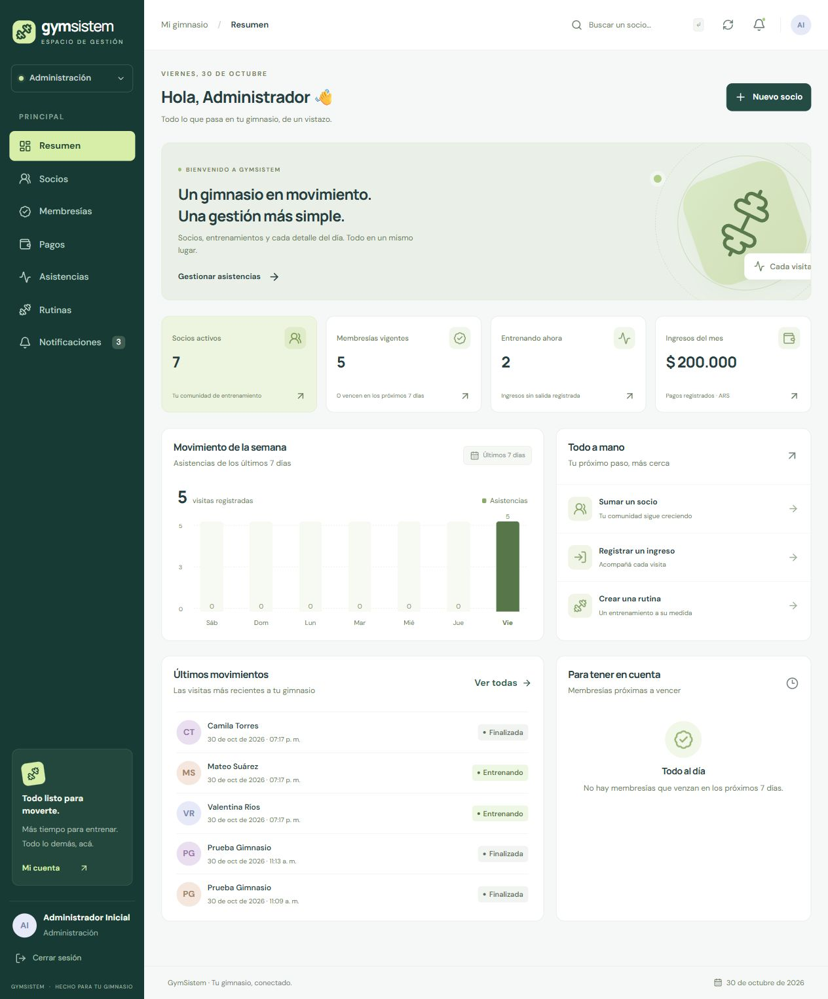

## Stack utilizado

| Tecnología | Uso |
|---|---|
| React 19 | Interfaz y componentes |
| TypeScript | Tipado estricto y contratos con la API |
| Vite | Desarrollo y compilación |
| Bootstrap 5.3 | Grillas, formularios y estilos base adaptables |
| React Router | Navegación y rutas por perfil |
| Context API y hooks | Sesión, datos y estado compartido |
| Fetch API | Comunicación con el gateway y manejo de errores |
| Lucide React | Iconografía |
| DM Sans · Manrope | Tipografías incluidas localmente |
| Vitest · Testing Library · jsdom | Pruebas automatizadas |

## Funcionalidades

- **Inicio de sesión:** autenticación JWT, restauración del perfil, expiración de sesión y cierre de sesión.
- **Resumen:** indicadores calculados desde la API, gráfico de asistencias de los últimos siete días, movimientos recientes y membresías próximas a vencer.
- **Socios y equipo:** listado con búsqueda paginada en servidor, filtros, detalle de cuenta, alta, edición, desactivación y exportación CSV de la página visible.
- **Membresías:** creación, edición, cancelación y consulta de estados, importes y vigencia.
- **Pagos:** registro administrativo, edición/anulación, filtros por mes y medio de pago y total de la vista. Los importes conservan sus centavos.
- **Asistencias:** registro de ingresos y salidas, personas presentes e historial con fecha, horarios y duración.
- **Rutinas:** entrenamientos personalizados, búsqueda, filtro por socio y detalle del entrenamiento.
- **Notificaciones:** bandeja personal, avisos sin leer, lectura individual o múltiple y envío de avisos por el equipo.
- **Perfil:** consulta de datos de contacto y rol.
- **Estados de interfaz:** carga, resultados vacíos, errores recuperables, confirmaciones y avisos de éxito.

## Perfiles de acceso

| Perfil | Experiencia |
|---|---|
| Administración | Gestión de socios, membresías, pagos, asistencias, rutinas y avisos |
| Entrenador | Consulta de socios y membresías por socio; gestión de rutinas y asistencias; sus pagos y avisos personales |
| Socio | Su membresía, pagos, entrenamientos, historial, notificaciones y registro de su ingreso/salida |

La interfaz adapta las acciones visibles al perfil. El backend vuelve a verificar los permisos de cada operación y la propiedad de los datos.

## Diseño responsive

El menú lateral se transforma en un panel móvil con control de foco y fondo inactivo. Las tablas se presentan como tarjetas en pantallas pequeñas, y los formularios se reorganizan según el ancho disponible. Incluye etiquetas visibles, navegación por teclado y soporte para movimiento reducido.

Se verificaron tamaños de **360, 390, 768, 1024 y 1440 px**, sin desbordamiento horizontal del documento en las vistas comprobadas.

<p align="center">
  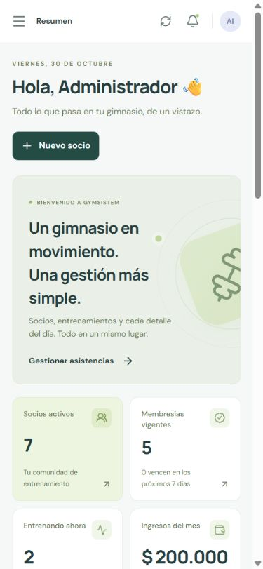
  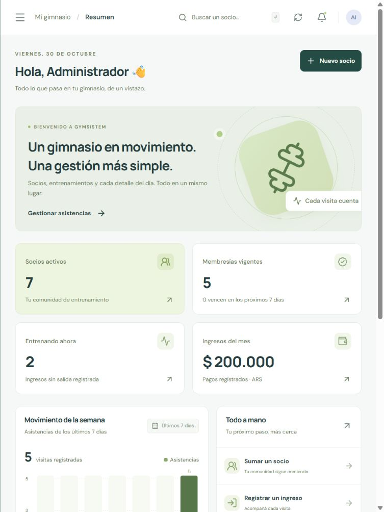
</p>

## Capturas de las secciones

Las capturas corresponden a la aplicación real conectada al backend. Los registros de ejemplo utilizan **datos ficticios de demostración**; no muestran credenciales ni tokens.

<details>
<summary>Ver ingreso y todas las secciones</summary>

### Ingreso

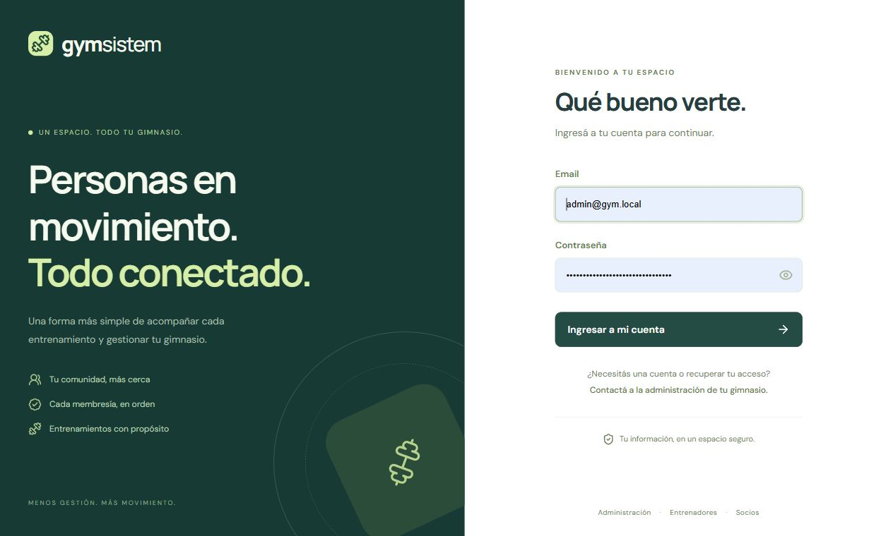

### Resumen


### Socios

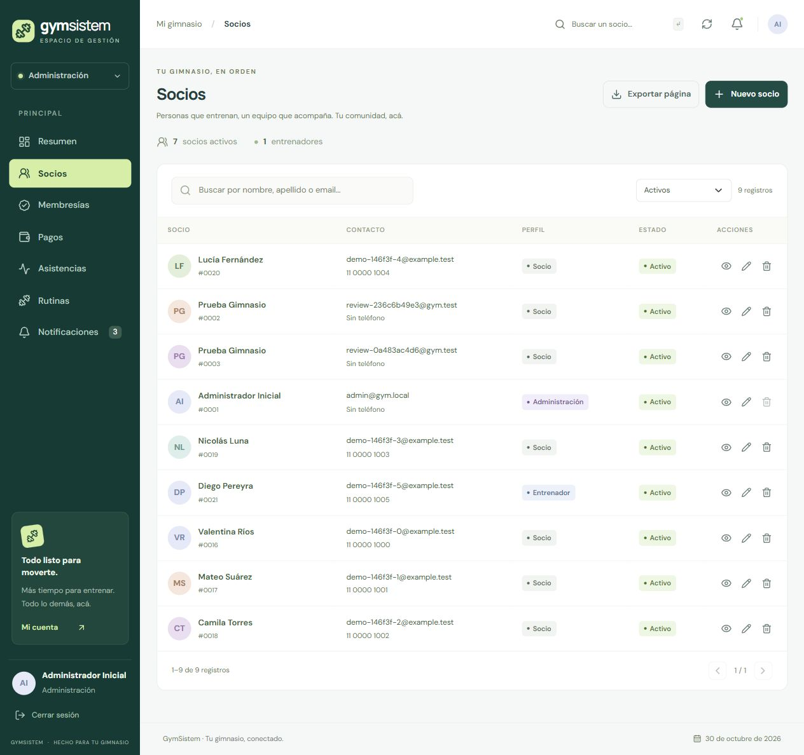

### Membresías

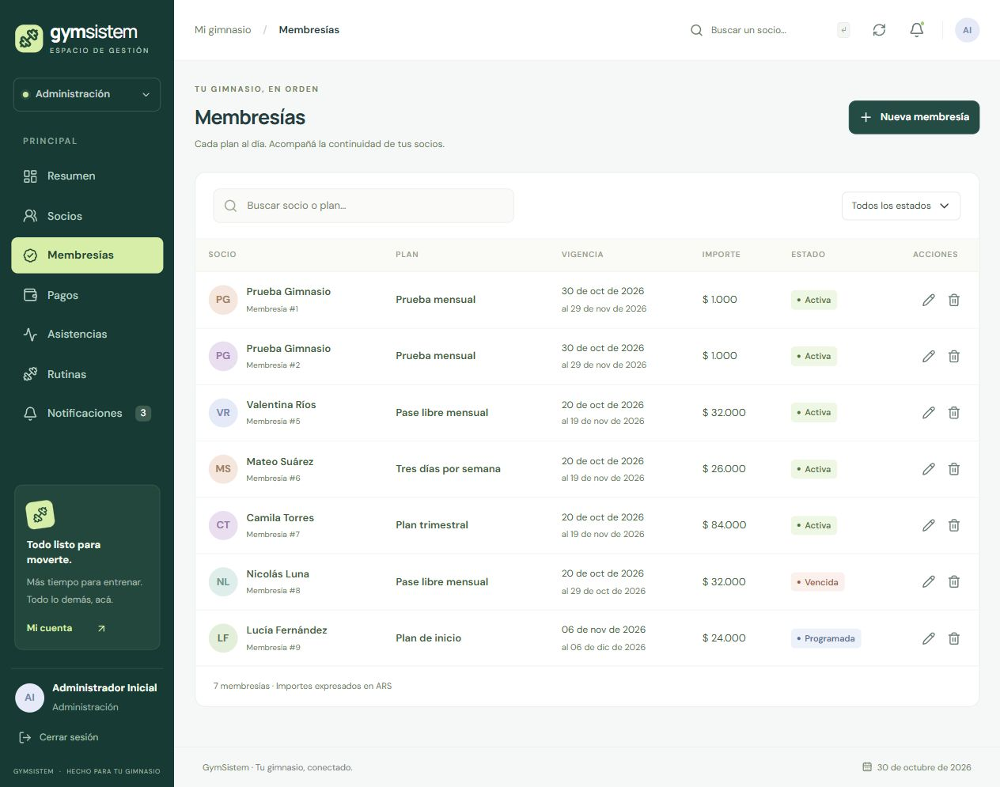

### Pagos

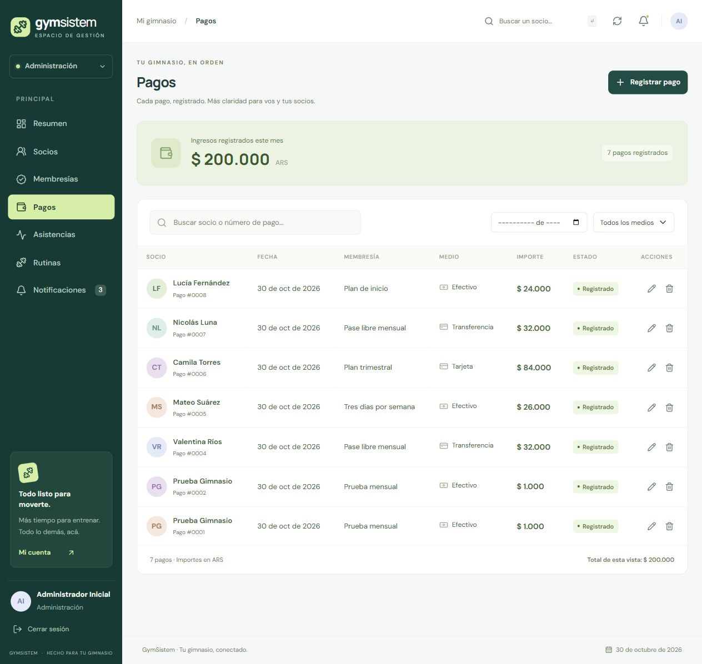

### Asistencias

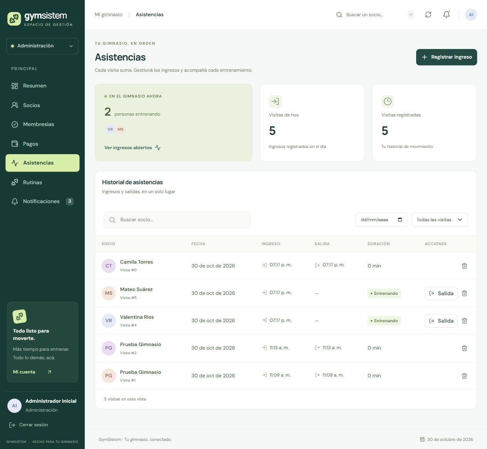

### Rutinas

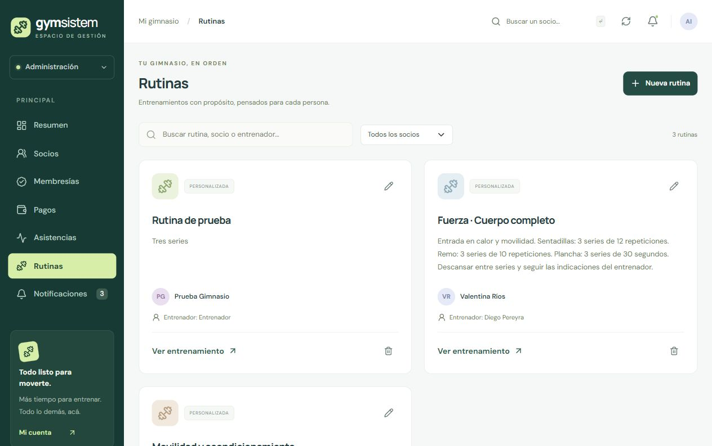

### Notificaciones

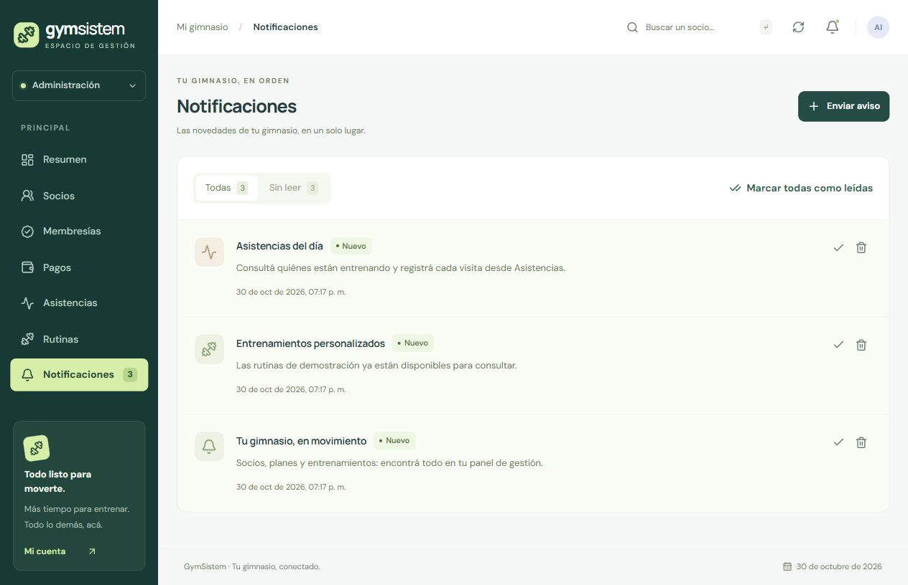

### Perfil

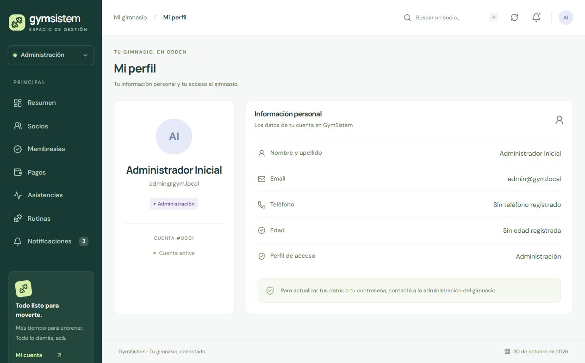

</details>

## Instalación y desarrollo

Recomendado: **Node.js 24** y npm. El backend debe estar iniciado por separado.

```bash
git clone https://github.com/maximartinatto/gym-system-frontend.git
cd gym-system-frontend
npm ci
npm run dev
```

La interfaz de desarrollo se sirve en `http://localhost:5173`. Utiliza `/api` y el proxy de Vite para comunicarse con el gateway. El destino local predeterminado es `http://127.0.0.1:8088`.

Si se ejecuta el backend con el puerto 8080 predeterminado de su configuración, cambiar el destino del proxy mediante `API_PROXY_TARGET`. Por ejemplo, en PowerShell:

```powershell
$env:API_PROXY_TARGET = "http://localhost:8080"
npm run dev
```

En otros entornos puede configurarse `VITE_API_BASE_URL` con la dirección pública de la API. Las variables `VITE_*` se incluyen en el navegador y solo deben contener configuración pública; nunca claves del backend ni contraseñas.

El acceso requiere una cuenta creada en el backend. No se incluyen credenciales predeterminadas.

## Pruebas y compilación

```bash
npm test
npm run build
```

**16 pruebas automatizadas** cubren transmisión del Bearer, errores de API, abortos de búsqueda, login, restauración y salida de sesión, formatos de fecha e importes con centavos. La compilación ejecuta el chequeo estricto de TypeScript y genera `dist/`.

También se verificaron recorridos reales de los tres perfiles: búsqueda y edición de socios, alta de membresía, registro de pago, ingreso/salida, creación y lectura de rutinas, lectura de avisos y exportación CSV.

## Estructura

```text
src/
├── components/    # Formularios, tablas, modales y avisos compartidos
├── contexts/      # Sesión y datos de los servicios
├── hooks/         # Operaciones reutilizables
├── layout/        # Navegación y estructura de la aplicación
├── pages/         # Pantallas por funcionalidad
├── test/          # Configuración de pruebas
├── api.ts         # Cliente HTTP y errores
├── lib.ts         # Formatos, búsqueda y helpers
└── types.ts       # Contratos de dominio
```

## Alcance

La aplicación depende del backend para guardar datos; no reemplaza errores de servicio con información simulada. La sesión se mantiene por pestaña en `sessionStorage`. Los pagos son registros administrativos, no una pasarela de cobro. La presentación de importes utiliza ARS, de acuerdo con el alcance actual del proyecto.
